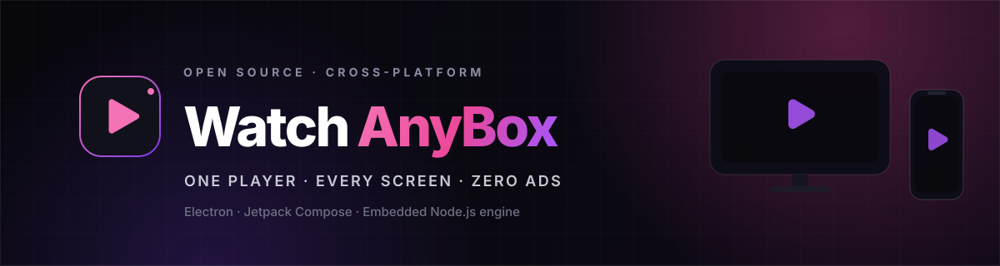

<div align="center">



<h1>WatchAnyBox</h1>

<p><strong>One player. Every screen. Zero ads.</strong><br />
A cross-platform, privacy-first streaming media center for Windows and Android — built on Electron, Jetpack Compose, and a shared embedded Node.js engine.</p>

<p><sub><samp><kbd><b>SIGNAL</b></kbd> &nbsp;·&nbsp; <b>ENGINE:</b> ONLINE &nbsp;·&nbsp; <b>TRACE:</b> ZERO &nbsp;·&nbsp; <b>ADS:</b> <span style="color: #FF0000;">TERMINATED ON SIGHT</span></samp></sub></p>

```diff
- HISTORY: NOT WRITTEN. TRACKERS: BLOCKED PRE-RENDER. ESCAPE ROUTES: NONE.
```

[](https://github.com/mohdziauddin2006-cloud/watchanybox/releases/latest)
[](https://github.com/mohdziauddin2006-cloud/watchanybox/releases)
[](#downloads)
[](LICENSE)
[](https://github.com/mohdziauddin2006-cloud/watchanybox)
[](https://github.com/mohdziauddin2006-cloud/watchanybox/commits/main)

[**Download**](#downloads) · [**Features**](#core-features) · [**Architecture**](#architecture) · [**Quick start**](#developer-quick-start) · [**Privacy**](#privacy-by-design)

</div>

---

WatchAnyBox turns the messy business of streaming into one quiet, native surface. A local extraction engine resolves sources, the player mounts them inside the app, and a network-level shield removes ads, popups, and trackers before they load. Nothing you watch is <span style="color: #FF0000;">ever written to disk</span>.

The same engine powers a **Windows desktop app** and a **native Android app** that adapts from phone to tablet to desktop-class windows. One catalogue, one player, one consistent experience — no browser handoff, no accounts, no telemetry.

> <span style="color: #FF0000;">**No ads. No history. No external browser.**</span> Just the thing you came to watch.

---

## 01 // PROTOCOL: ACQUISITION

<p align="center">
  <a href="https://github.com/mohdziauddin2006-cloud/watchanybox/releases/download/v1.0.0/WatchAnyBox-Setup-3.0.0.exe">
    
  </a>
  &nbsp;&nbsp;
  <a href="https://github.com/mohdziauddin2006-cloud/watchanybox/releases/download/v1.0.0/WatchAnyBox.apk">
    
  </a>
</p>

<p align="center">
  <sub>Latest stable release: <a href="https://github.com/mohdziauddin2006-cloud/watchanybox/releases/tag/v1.0.0"><strong>v1.0.0</strong></a> &nbsp;·&nbsp; Windows 10/11 x64 &nbsp;·&nbsp; Android 7.0+ &nbsp;·&nbsp; <a href="https://github.com/mohdziauddin2006-cloud/watchanybox/releases">all releases</a></sub>
</p>

| Platform | Artifact | Size | Direct download |
|:--|:--|--:|:--|
| 🪟 **Windows** | `WatchAnyBox-Setup-3.0.0.exe` — NSIS installer (x64, per-user) | 106.6 MB | [**Download EXE →**](https://github.com/mohdziauddin2006-cloud/watchanybox/releases/download/v1.0.0/WatchAnyBox-Setup-3.0.0.exe) |
| 🤖 **Android** | `WatchAnyBox.apk` — universal (arm64-v8a, armeabi-v7a, x86, x86_64) | 133.4 MB | [**Download APK →**](https://github.com/mohdziauddin2006-cloud/watchanybox/releases/download/v1.0.0/WatchAnyBox.apk) |

<details>
<summary><strong>Windows — first launch</strong></summary>

1. Download `WatchAnyBox-Setup-3.0.0.exe` and run it.
2. The installer sets up the app per-user (no admin prompt) and adds a desktop + Start menu shortcut. Choose a custom folder if you like.
3. If SmartScreen appears, choose **More info → Run anyway** (the build is unsigned).
4. Launch **WatchAnyBox** from the shortcut. The UI is served locally from `http://127.0.0.1:46900`; the extraction engine binds `46901–46903`.

</details>

<details>
<summary><strong>Android — first install</strong></summary>

1. Download `WatchAnyBox.apk` on your device.
2. Allow installs from your browser or file manager when prompted.
3. Open the APK and install. Requires **Android 7.0 (API 24)** or newer.
4. On first launch the embedded engine starts in-process — no account, no setup.

</details>

<details>
<summary><strong>SHA-256 checksums</strong></summary>

| Artifact | SHA-256 |
|:--|:--|
| `WatchAnyBox-Setup-3.0.0.exe` | `180f54f4246e533c983977a574f2b2adeff3f7b210c2f5bea479d00aacefc930` |
| `WatchAnyBox.apk` | `c0ef79f067e65f9f41c485ad26d55e8e85120d5e7f47ad8de7319261da9cc741` |

</details>

---

## 02 // CAPABILITY_REGISTRY

| | Feature | What it does |
|:--:|:--|:--|
| 🪟🤖 | **Multi-Platform** | A Windows installer and a universal Android APK share the same catalogue, engine, and player behaviour. |
| 🕵️ | **Zero-History Privacy** | No watch history, search log, resume state, or telemetry. Only an optional TMDB key and your metadata language are stored locally. |
| 🗣️ | **Smart Language Priority** | Audio and subtitle tracks are ranked **Hindi → English → original**, automatically, wherever a stream exposes multiple tracks. |
| 🔐 | **Secure Vault** | The 18+ catalogue is compartmentalized behind one dedicated destination, excluded from Home's Super Search and every SFW row — a hard content boundary, intentionally frictionless rather than a PIN gate. |
| 📐 | **Adaptive UI** | Material 3 window size classes switch the Android shell between bottom navigation and a navigation rail; the desktop layout keeps a persistent sidebar. |
| 🛡️ | **Network-Level Ad Shield** | Ad, tracker, popunder, and analytics requests are blocked before they load, in Electron's session layer and inside proxied player pages. Media hosts are allow-listed first. |
| 🔁 | **Silent Source Fallback** | Dead mirrors, Cloudflare challenges, and slow upstreams roll over to the next live provider automatically — one clean "Stream unavailable" overlay only if everything fails. |
| 📡 | **Live TV & Tube** | Dedicated Live TV and ad-free YouTube surfaces live inside the app, with no external-browser handoff and no YouTube chrome. |

---

## 03 // NETWORK_ARCHITECTURE

<p align="center"><sub>One shared extraction engine. Two native shells.</sub></p>

```text
┌─────────────────────────────────┐     ┌─────────────────────────────────┐
│  WINDOWS · Electron 44          │     │  ANDROID · Jetpack Compose      │
│  main.js · preload.js           │     │  Material 3 Adaptive shell      │
│  renderer · hls.js              │     │  Media3 ExoPlayer · OkHttp      │
└────────────────┬────────────────┘     └────────────────┬────────────────┘
                 │ 127.0.0.1:46900                        │ 127.0.0.1:46900
                 └───────────────────┬────────────────────┘
                                     ▼
                   ┌───────────────────────────────────────┐
                   │  SHARED ENGINE · srv2.js (Node.js)    │
                   │  extractor · proxy · HLS relay        │
                   │  ad shield · source fallback          │
                   │  127.0.0.1:46901–46903                │
                   └───────────────────────────────────────┘
```

On Windows, `srv2.js` runs directly inside Electron. On Android, the same unmodified engine runs on an **embedded Node.js 22 runtime via Javet**, inside the app process, behind a loopback reverse proxy. No remote backend, no cloud dependency.

### Tech stack

| Layer | Windows | Android | Shared |
|:--|:--|:--|:--|
| **Shell** | Electron 44 | Jetpack Compose + Material 3 | — |
| **UI** | HTML / CSS / JavaScript + hls.js | Adaptive Compose shell + bundled WebView catalogue | Catalogue assets |
| **Player** | HTML5 `<video>` + isolated embeds | Media3 ExoPlayer (HLS + progressive) | — |
| **Engine** | Node.js inside Electron | Node.js 22 via Javet | `srv2.js` |
| **Networking** | Electron session + local HTTP | OkHttp + local reverse proxy | `127.0.0.1:46900–46903` |
| **Privacy** | Zero-history renderer | Zero-history app, `allowBackup=false` | No telemetry |

### Repository map

```text
watchanybox/
├── main.js                  # Electron main process, local server, ad/popup shield
├── preload.js               # Isolated context bridge + in-frame player guards
├── renderer.js              # Catalogue UI, player, Super Search, language engine
├── srv2.js                  # Shared extractor / proxy / HLS relay (ports 46901–46903)
├── sources.js               # Catalogue definitions, vault, Live TV, Tube
├── libraries.js             # Custom-library scrapers
├── index.html · styles.css  # Desktop UI shell
├── hls.min.js               # HLS playback for desktop
├── docs/banner.svg          # Project banner
└── android_app/             # Kotlin · Compose · Material 3 · Media3
    ├── app/src/main/assets/ # Bundled web catalogue + shared engine
    └── app/src/main/java/com/watchanybox/app/
        ├── App.kt · MainActivity.kt
        ├── LocalStreamServer.kt   # Asset server + reverse proxy (:46900)
        ├── NodeBackend.kt         # Embedded Node 22 (Javet)
        ├── Shell.kt               # Adaptive navigation + WebView host
        ├── DiscoverScreen.kt      # Native TMDB grid
        └── NativePlayerScreen.kt  # ExoPlayer surface
```

---

## 04 // DIRECTIVE: ZERO-TRACE PROTOCOL

- **<span style="color: #FF0000;">Zero history, permanently.</span>** Watch history, searches, resume points, and "continue watching" rows are never written. Legacy keys are purged on boot; only `wab.key` (optional TMDB key) and `wab.lang` (metadata language) persist.
- **Local-first networking.** The UI and engine bind to loopback only — `127.0.0.1` on ports `46900–46903`. Nothing is exposed to your network.
- **No accounts, no telemetry, no analytics.** There is no sign-in, no device fingerprinting, and no usage reporting.
- **Android backup disabled.** `allowBackup="false"` keeps app data out of cloud backups.
- **A real content boundary.** The 18+ vault is a separate destination, absent from Home's Super Search and all safe-for-work rows. Access is intentionally frictionless; it is a segregation boundary, not a PIN lock.
- **Ads blocked before render.** Tracker, popunder, and ad-network requests are denied at the session layer, with media hosts allow-listed so legitimate streams are never caught by the rule set.

---

## 05 // DIRECTIVE: SPIN UP THE CORE

### Prerequisites

| Tool | Version |
|:--|:--|
| **Node.js** | 18+ (Node 22 recommended) |
| **JDK** | 17 (Android build) |
| **Android SDK** | Platform 34 + Build Tools 34.x |
| **Git** | Any recent version |

### 🪟 Windows (Electron)

```bash
git clone https://github.com/mohdziauddin2006-cloud/watchanybox.git
cd watchanybox

npm install
npm start
```

The Electron window loads `http://127.0.0.1:46900`; the extractor starts alongside it on `46901–46903`. There is no separate backend to launch.

### 🤖 Android (Jetpack Compose)

```bash
cd android_app

# Windows PowerShell / CMD
.\gradlew.bat assembleRelease

# macOS / Linux
./gradlew assembleRelease
```

The universal APK is written to:

```text
android_app/app/build/outputs/apk/release/app-universal-release.apk
```

Install it on a connected device:

```bash
adb install -r app/build/outputs/apk/release/app-universal-release.apk
```

For a faster debug loop, use `.\gradlew.bat installDebug` (Windows) or `./gradlew installDebug` (macOS/Linux).

---

## 06 // SUBMISSIONS TO THE CORE

Focused bug reports and pull requests are welcome. Please keep the project's core guarantees intact:

- **Zero history** — no new persistence of viewing or search activity.
- **Loopback only** — no new externally reachable services.
- **No ad or tracker calls** — media allow-listing stays explicit.
- **One player surface** — no external-browser handoff for standard playback.

Open an issue with reproduction steps, platform, and app version. For larger changes, open an issue first to agree on the approach before writing the patch.

---

## 07 // LEGAL DIRECTIVES

WatchAnyBox **does not host, store, or distribute media**. It is a local player and proxy interface that resolves streams from third-party sources. All content is provided by those third parties, and users are responsible for accessing only material they are legally permitted to view in their jurisdiction.

The 18+ vault is intended strictly for adults of legal age. Nothing in this repository is legal advice.

---

## 08 // LICENSE

Released under the **MIT License**. See [LICENSE](LICENSE) for details.

---

<div align="center">

<sub>Built with ❤️ by <a href="https://github.com/mohdziauddin2006-cloud"><strong>mohdziauddin2006-cloud</strong></a> — <kbd><span style="color: #FF0000;">THE ENGINE NEVER LEAVES YOUR MACHINE.</span></kbd></sub>

<sub>If WatchAnyBox is useful to you, consider giving it a ⭐ — it helps others find the project.</sub>

</div>
